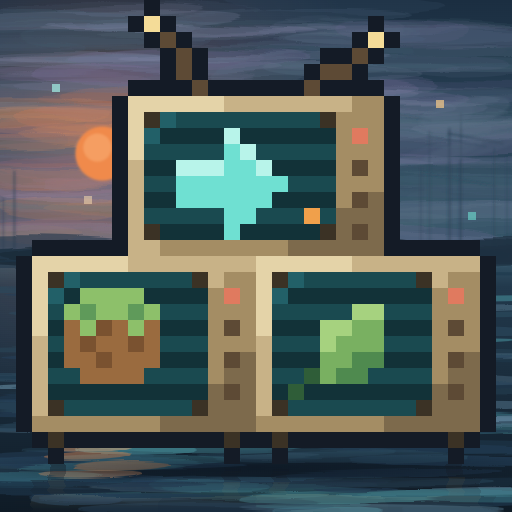
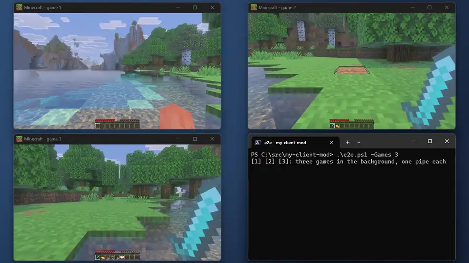

# Be.D.D.



English | [简体中文](README.zh-CN.md)

[](https://github.com/LiteLDev/BeDD/releases)
[](COPYING.LESSER)
[](https://docs.levimc.org/BeDD/)

Be.D.D. (Bedrock Deep Dive) is named after the H.D.D. of Zenless Zone Zero: a Proxy guides agents through the
Hollows from afar, your script guides Minecraft from the background.

Run end-to-end tests of your [LeviLamina](https://github.com/LiteLDev/LeviLamina) client mods
**in the background**. Your script (or your agent) plays Minecraft Bedrock over a local WebSocket,
while your own mouse, keyboard and windows stay yours, and several games can play at once.

Be.D.D. is a testing toolkit, not a mod for players: one app, `BeDD.exe`, that clones, starts and
shows the games, and a client-side LeviLamina module it puts into each game for a run.
**Documentation: <https://docs.levimc.org/BeDD/>**

<p align="center"></p>

> [!WARNING]
> This is a **testing tool**. A game with Be.D.D. in its `mods\` folder ignores your real mouse
> and keyboard and shows up only in the manager window. Do not leave it in a game you play.

## Features

- **Keep using your PC.** The game never takes the foreground, the cursor or your keystrokes, and
  your clicks never land in it.
- **Agent-friendly: meaning first, pixels last.** Three ways to drive a game, all on at once:
  semantic ops through [bedboo](https://github.com/LiteLDev/bedboo) (the default: walk, look, use
  items, chat, read the world as data), a UI tree of the screen (an accessibility-tree snapshot with
  refs to click, type into and scroll), and simulated keyboard, mouse and screenshots as the last
  resort. Scripts and agents reach for screenshots only when nothing else will do, which saves a lot
  of tokens.
- **One app.** `BeDD.exe` is the whole client: double-click it for the manager window, or run
  `BeDD.exe <noun> <verb> [--json]` from any script. No PowerShell, no setup scripts, no runtime to
  install.
- **Any language.** The game speaks JSON over a local WebSocket (`ws://127.0.0.1:<port>/v1`,
  with a token), described by an [AsyncAPI spec](spec/bedd.asyncapi.yaml).
- **Several games at once.** Each slot is a hardlinked clone of your LeviLauncher instance, made in
  seconds, with its own WebSocket.
- **One window for all of them.** The games of every test run on the PC show up live in one
  manager window instead of popping up on your desktop; closing it closes them all.
- **Plays like a player.** Keys, chat, key bindings, menus, hover tooltips, clicks and the camera
  all work as with a real mouse and keyboard.
- **Deterministic.** Every call returns once the game has handled it, so no guessing sleeps.
- **Screenshots of covered windows.** The manager window can sit behind your other windows.

<p align="center"></p>

## Install

Run `bedd-windows-x64-setup.exe` from the [releases](https://github.com/LiteLDev/BeDD/releases). It
installs for you alone, without administrator rights, to `%LOCALAPPDATA%\Programs\BeDD`, puts
`BeDD.exe` on your `PATH` and adds **BeDD** to the Start menu. `bedd-windows-x64.msi` is the same for
silent installs (`msiexec /i bedd-windows-x64.msi /qn`); `bedd-windows-x64.zip` needs no installer:
unzip it anywhere. Either way you get:

| | |
|---|---|
| `BeDD/BeDD.exe` | the app: manager window and command line |
| `BeDD/mod/BeDD/` | the client module `BeDD.exe` puts into a game instance for a run |
| `BeDD/mod/BeDD-server/` | the module for a Bedrock Dedicated Server (client and server mode) |
| `BeDD/spec/` | `bedd.asyncapi.yaml`, the WebSocket protocol |

Needs Minecraft Bedrock Edition **1.26.60** (GDK) with LeviLamina **26.60.x** (client), installed
as an instance of [LeviLauncher](https://github.com/LiteLDev/LeviLauncher) **1.1 or newer**. Be.D.D.
is not a lip package and is not listed on LeviMC Mods. Only the test PC's game needs it; servers
and players do not.

### Your instance stays yours

LeviLauncher owns your instance; `BeDD.exe` only reads it (`LeviLauncher.exe instance list --json`)
and never writes into it. Every game Be.D.D. runs, slot 1 included, is a clone of it under
`%LOCALAPPDATA%\BeDD\instances\<gameVersion>-<slot>`: game files are hardlinks (copies when the
instance is on another volume), so a clone takes seconds and little space, and has its own `mods\`,
logs, worlds and options. A clone is refreshed when the instance changes. Everything else of
Be.D.D. lives under `%LOCALAPPDATA%\BeDD` too (`BEDD_HOME` moves it).

```
BeDD.exe instance list              # clones, and with --all the LeviLauncher instances they come from
BeDD.exe instance clone --slot 2    # or let launch make it
BeDD.exe instance remove 1.26.60.05-2
```

Set `BEDD_LEVILAUNCHER` when `LeviLauncher.exe` is not where BeDD looks for it.

## How to use

```
BeDD.exe launch --slot 2 --json
```

starts the game of slot 2 headless, in the manager window, without taking the focus, and prints
where to reach it: its `pid`, `instance`, and the WebSocket `url` and `token` (the same as
`%LOCALAPPDATA%\BeDD\run\<pid>.json`). Then talk to it from anything that speaks WebSocket, here
Node 22 or newer (`node try.mjs`):

```js
import { execFileSync } from 'node:child_process';
const { url, token } = JSON.parse(execFileSync('BeDD.exe', ['launch', '--slot', '2', '--json']));
const ws = new WebSocket(`${url}?token=${token}`), waiting = new Map(); let id = 0;
ws.onmessage = (e) => { const m = JSON.parse(e.data); waiting.get(m.id)?.(m); waiting.delete(m.id); };
const call = (op, args = {}) => new Promise((r) => { waiting.set(++id, r); ws.send(JSON.stringify({ id, op, ...args })); });
await new Promise((r) => { ws.onopen = r; });
console.log(await call('ping'), await call('world')); ws.close(); // modes on offer; in a world? the screen, the player
```

Every message is a JSON object: a request `{id, op, ...}` gets `{id, ok:true, ...}` or
`{id, ok:false, error, code}`. `ping` lists what the game offers, by mode:

| Mode | Ops | Use it for |
|---|---|---|
| **bedboo** (default) | `world`, `look`, `input`, `slot`, `action`, `button`, `settings`, `send`, `stack`, `timescale`, `join`, `tap` | play by meaning: read the world, turn, walk, use items, chat and run commands, move items; [bedboo](https://github.com/LiteLDev/bedboo) speaks these for you |
| **UI tree** | `ui` | read the screen as an accessibility tree (roles, names, text, values, bounds) and click, set text or scroll a node by its `ref` |
| **input** (last resort) | `key`, `text`, `mouse`, `raw`, `release`, `flush`, `focus`, `window`, `screenshot` | what a player's hands do, and the picture; costly for an agent, so only when the others cannot |

Each request returns once the game has handled it. The protocol is in
[`spec/bedd.asyncapi.yaml`](spec/bedd.asyncapi.yaml) (AsyncAPI 3.0) and on the
[WebSocket reference](https://docs.levimc.org/BeDD/reference/websocket).

`BeDD.exe ps` lists the running games (`--json` with their `url` and `token`), `BeDD.exe stop <pid>`
closes one, and `BeDD.exe help` lists every command. Every command takes `--json`, prints only its
result on stdout, and exits non-zero with a hint when it fails.

### Several games at once

```
BeDD.exe launch --slot 2 --label checkout --json
BeDD.exe launch --slot 3 --label settings --json
BeDD.exe ps
```

Each slot is its own clone with its own WebSocket. A few rules keep parallel runs from tripping
over each other:

- Find your game by its **pid or instance folder** (`ps --json`), never just by the name
  `Minecraft.Windows` (or you close someone else's game).
- Make test worlds single-player with `BeDD.exe world singleplayer <worldDir>`: games on one PC
  share an online sign-in, and multiplayer worlds opened at the same time fail with "An error has
  occurred" (code "Blaze").

### Client and server

Besides a game on its own (in a singleplayer world, or joined to a remote server), Be.D.D. runs a
Bedrock Dedicated Server with BeDD's server module next to the game, both scripted over WebSocket,
the server's game speed leading the client's:

```
BeDD.exe server init s1       # BDS 1.26.60 + LeviLamina via lip, ports from 19140
BeDD.exe server start s1      # no window; its WebSocket shows up in ps
BeDD.exe server stop s1
```

See [Client and server modes](https://docs.levimc.org/BeDD/guide/modes).

### The manager window

Double-click `BeDD.exe` (or let the first `launch` start it) and every game shows up there as a
live picture, and nowhere else: its own window stays off screen, with no taskbar button and nothing
in Alt+Tab, so no windows pop up and vanish while several runs start and close games. It never
takes the focus.

- Each game is labelled with its `--label` (or the project that started it), its instance and pid,
  and whether input is arriving.
- **Closing the manager window closes every game in it** (it asks first). A game that the manager
  does not attach within 30 s, or that loses it, closes itself, so nothing is left running in the
  background.
- Double-click a game to show only that one. Right-click it to open its `latest.log` or instance
  folder, or to close it.
- From a script: `BeDD.exe manager status`, `BeDD.exe manager stop`.

### Plug it into a harness

A harness in any language does the same few steps:

```
BeDD.exe instance clone --slot 2 --json           # where the clone is (its mods\ and worlds)
BeDD.exe mod install 1.26.60.05-2                 # put the BeDD module in; config with mod config
BeDD.exe world singleplayer <the clone's world>   # after restoring your test world
BeDD.exe launch --slot 2 --json                   # url + token; drive it over WebSocket
BeDD.exe stop <pid>; BeDD.exe mod uninstall 1.26.60.05-2
```

Deploy your own mod into the clone's `mods\` next to it, and keep `BeDD` out of any "move other mods
aside" step: `mod install` puts it in fresh each run and `mod uninstall` takes it out.

With [bedboo](https://github.com/LiteLDev/bedboo), a test is a mineflayer-style bot that plays the
real client: `transport: 'bedd'` connects to the game's WebSocket, reads the game's packets from the
tap and turns what the bot does into the ops above.

[BeetrootSkin](https://github.com/MiracleForest/BeetrootSkin/tree/main/tools/e2e) and
[AlleviatedBackpacks](https://github.com/MiracleForest/AlleviatedBackpacks/tree/main/tools/e2e) have
complete harnesses to copy from.

## Settings

`mods\BeDD\config\config.json` of the clone, written by `BeDD.exe mod install` and changed with
`BeDD.exe mod config`. Without it the game still runs headless, with the defaults. `mod install`
also switches the clone's LeviLamina to its built-in crash logger
(`modules.crashLogger.builtin` in `mods\LeviLamina\config\Config.json`): the default
`CrashLogger.exe` is a console program, and its console window would flash on the desktop at every
game start.

```json
{ "clientWidth": 1600, "clientHeight": 900, "wsPort": 0 }
```

| Key | |
|---|---|
| `clientWidth`, `clientHeight` | game window size (0 = leave it), so clicks land in the same place every run |
| `wsPort` | default `0`: the WebSocket's port on 127.0.0.1 (0 = any free port; the discovery file and `launch --json` tell which) |
| `wsMaxClients` | default `8`: connections at once (each one's held keys, buttons and `input` override are released when it disconnects) |
| `allowOrigins` | default `[]`: browser origins allowed to connect; any request with an `Origin` header is refused unless listed here |
| `manager` | default `true`: the game closes when no manager window attaches within 30 s, or when it loses it. `false` keeps it hidden and running without one (for CI) |
| `loopbackOnly` | default `true`: the game stays on the PC, so no Windows Firewall prompt for each new instance, and game servers outside the PC are not queried (they could show up as "LAN worlds" ahead of your test world). Dedicated servers your harness starts still ask once per server folder; **Cancel** is fine |
| `mode` | where the world runs: `ClientOnly` (default: a local world), `ClientServer` (a dedicated server with BeDD on this PC; `loopbackOnly` stays), `Remote` (a server without BeDD, possibly off the PC). See [Debug modes](https://docs.levimc.org/BeDD/guide/configuration#debug-modes). `state` and `join` report it |
| `allowHosts` | host names or addresses `loopbackOnly` still lets the game reach (Remote mode's server). Those hosts are queried, the game's outgoing UDP socket can reach them without a firewall prompt, and datagrams to any other host off the PC are refused (`state` `stats.sendsRefused`). Hosts on the PC need no entry |
| `mute` | ignored: a BeDD game is always silent (FMOD opens no audio device); `false` only logs a warning |
| `trace` | log every input that reaches the game to `logs\latest.log`, for bug reports |
| `timeScale` | default `1`: the game speed (0.05..20) of every world this game hosts, set when it enters one (the `timescale` op changes it later; on a remote server it does nothing) |
| `gameHooks` | default `true`: hook the game's own systems for the bedboo ops `world`, `look`, `input`, `slot`, `action` and `button` |
| `ui` | default `true`: the `ui` op (UI tree) |
| `tap` | default `true`: the `tap subscribe` stream of the game packets the client receives and sends, for bedboo, with a join journal so a reader can attach in the middle of a session. While it is on the client asks servers not to use its blob cache, so every chunk arrives in full |
| `tapLoopback` | default `true`, used only with `tap`: also tap singleplayer worlds and LAN worlds this game hosts (packets re-serialized; LAN guests' traffic is left out) |
| `tapJournalMiB` | default `128`: size cap of the tap's join journal; past it a late attach is incomplete (`complete:false`) |
| `allowSend` | default `true`: the `send` op, with which bedboo makes the client send chat and commands it serialized |
| `sendAllow` | packet ids `send` may send, default `[9, 77, 78, 97]` (text, command_request, command_block_update, book_edit: what the player can type or write in the game's own screens); login, inventory_transaction, player_auth_input and item_stack_request are always refused |
| `allowStack` | default `true`: the `stack` op, with which bedboo makes the game send item stack requests (inventory moves, crafting, chest moves) for the signed-in player |

The token is the boundary: anything that has it can do what the signed-in player can. It is written
only to `%LOCALAPPDATA%\BeDD\run\<pid>.json`, which only your user can read. Set a feature key to
`false` to take its ops away (they then answer `code:"disabled"`).

## More

The full documentation, with more videos and pictures, is at <https://docs.levimc.org/BeDD/>.

Building it yourself, the protocol or how it works inside? See [CONTRIBUTING.md](CONTRIBUTING.md#development).

## License

[LGPL-3.0-or-later](COPYING.LESSER) © LeviMC. GameInput interface layouts follow Microsoft's public
`GameInput.h` (v2); no Microsoft code is included.
