# Be.D.D.


[English](README.md) | 简体中文

[](https://github.com/LiteLDev/BeDD/releases)
[](COPYING.LESSER)

Be.D.D.（Bedrock Deep Dive）得名自《绝区零》的 H.D.D.：绳匠在远处引导代理人穿行空洞，你的脚本在后台引导 Minecraft。

让 [LeviLamina](https://github.com/LiteLDev/LeviLamina) 客户端模组的端到端测试**在后台跑**。
脚本在 Minecraft 基岩版里按键、打字、点击，你的鼠标、键盘和窗口照常归你用，还能同时开好几个游戏一起测。

<p align="center"></p>

> [!WARNING]
> 这是**测试工具**。后台模式开着时，游戏不理会你真实的鼠标和键盘。别把它留在平时玩的游戏里
> （在游戏窗口按 **Ctrl+Shift+F12** 可以关掉后台模式）。

## 功能

- **测试时照常用电脑。** 游戏不抢前台、不锁鼠标、不吃你的按键，你点哪儿都不会点进游戏里。
- **多开一起测。** 每个游戏实例一条自己的管道；克隆一个实例只要几秒钟。
- **一个窗口看全部。** 电脑上所有测试的游戏都实时显示在同一个管理窗口里，不会在桌面上弹来弹去；关掉它就关掉全部游戏。
- **跟真人玩一样。** 按键、聊天、键位绑定、菜单、悬停提示、点击、转视角都和真鼠标键盘一样生效。
- **结果确定。** 每个调用都等游戏处理完输入才返回，不用靠猜的 `sleep`。
- **窗口被挡住也能截图。** 游戏可以躲在你其他窗口后面。
- **直接接进现有测试框架。** 一个文件替换掉 LeviLauncher 测试框架里常见的 `Click`、`Press-Key`、`Focus-Game` 等函数，测试场景一行不用改。

<p align="center"></p>

## 安装

装进跑测试的那个游戏实例，例如用 [lip](https://github.com/LiteLDev/lip)：

```powershell
lip install github.com/LiteLDev/BeDD#client
```

也可以从 [Releases](https://github.com/LiteLDev/BeDD/releases) 下载
`bedd-client-windows-x64.zip`，解压到该实例的 `mods\` 目录。多数测试框架会在每次运行开始时自己放进去、结束后删掉
（[见下文](#接入测试框架)）。

需要 Minecraft 基岩版 **1.26.51**（GDK 版）和 LeviLamina **26.51.x**（客户端），装在用 LeviLauncher 安装的游戏实例里。
测试时用 `Start-BeDDGame.ps1` 启动这个实例，不走启动器（[见下文](#多开)）。只有测试机上的游戏需要装，服务器和玩家都不用。

### 新电脑上

除了游戏本身，什么都不用提前手动准备。`Initialize-BeDD.ps1`（`Start-BeDDGame.ps1` 和 `clone-instance.ps1` 也会调用它）
会找到游戏实例，并把电脑上缺的东西补齐，每一步只做一次：

| 缺什么 | 怎么处理 |
|---|---|
| LeviLauncher | 用已安装的；没有就把最新版下载到 `%LOCALAPPDATA%\BeDD\tools` |
| 游戏本身 | 打开 LeviLauncher，脚本等你用拥有 Minecraft 的微软账号登录并装好 1.26.51（这一步脚本做不了；设了 `CI` 环境变量时直接报错并给出这些说明） |
| LeviLamina | 用 [lip](https://github.com/LiteLDev/lip) 装进实例；lip 和它需要的 .NET 运行时会自动下载（按用户安装，不需要管理员） |
| 游戏 exe 里 LeviLauncher 的加载器 | 通过 LeviLauncher 启动一次该实例让它加上，然后关掉游戏。没有加载器的话，游戏会用你平时的 Minecraft 数据，而不是实例自己的 |
| 克隆（`-Slot 2` 及以上） | 从基础实例克隆；基础实例之后有变化时会同步更新 |

```powershell
$i = & .\Initialize-BeDD.ps1 -Slot 2    # versions\<基础实例>-hi2 的 Name、Dir、ModsDir、PipeName
```

BeDD 从 `%APPDATA%\levilauncher.exe` 找 LeviLauncher 的数据，遵循它的"数据目录"设置（`base_root`），
并在其中挑 1.26.51 的实例（优先装了 LeviLamina 的）。要指向别处，设置 `BEDD_INSTANCE`（实例名）、`BEDD_VERSIONS_DIR`、
`BEDD_LAUNCHER_DATA`、`BEDD_LEVILAUNCHER`（LeviLauncher.exe）或 `BEDD_LIP`（lip.exe）。

测试框架也可以用同样的方式自己下载 BeDD，不必要求某个目录下事先有一份检出：

```powershell
$bedd = if ($env:BEDD_DIR) { $env:BEDD_DIR } else { Join-Path $env:LOCALAPPDATA 'BeDD\client' }
if (-not (Test-Path "$bedd\harness-shim.ps1")) {
    $zip = Join-Path $env:TEMP 'bedd.zip'
    Invoke-WebRequest https://github.com/LiteLDev/BeDD/releases/latest/download/bedd-client-windows-x64.zip -OutFile $zip
    Expand-Archive $zip (Split-Path $bedd) -Force; Rename-Item (Join-Path (Split-Path $bedd) 'BeDD') $bedd
}
```

## 使用方法

PowerShell 模块就放在模组旁边：

```powershell
Import-Module .\mods\BeDD\BeDD.psm1
Connect-BeDD                          # 等游戏启动好
Send-BeDDKey E                             # 打开背包
Send-BeDDMouse click -RX 0.5 -RY 0.474     # 按窗口比例位置点击
Send-BeDDKey T; Send-BeDDText '/give @s apple 3'; Send-BeDDKey ENTER
Save-BeDDScreenshot C:\temp\shot.png       # 窗口被挡住也能截
```

| 命令 | 作用 |
|---|---|
| `Connect-BeDD [-PipeName p]` | 等游戏就绪，并选定之后的调用发给哪个游戏 |
| `Send-BeDDKey E` | 按一下键；`-Action down`/`up` 按住或松开，`-Vk 0x10` 指定任意虚拟键码 |
| `Send-BeDDText '...'` | 输入文字（不产生按键，所以 `t` 不会打开聊天栏）；`-DelayMs` 设定每个字的间隔 |
| `Send-BeDDMouse click -RX 0.5 -RY 0.5` | `move`、`down`、`up`、`click`、`wheel`，位置用 `-X -Y` 像素或 `-RX -RY` 比例；`-Button right` 右键 |
| `Send-BeDDRaw move -Dx 200` | 在世界里转视角；`click -Button right` 使用物品 |
| `Clear-BeDDInput` | 松开所有还按着的键和鼠标按钮 |
| `Save-BeDDScreenshot path.png` / `Get-BeDDBitmap` | 游戏画面，被挡住也照样截 |
| `Set-BeDDWindow 1600 900` | 调整游戏窗口大小，不会把它提到前面 |
| `Set-BeDDBackground $false` | 把游戏交还给你的真鼠标和键盘 |
| `Get-BeDDState` | 游戏是否在线、收到了多少输入、是否抢过前台 |
| `Get-BeDDWorld` | 是否在世界中、当前界面、鼠标是否锁定、是否打开菜单、玩家位置与朝向（`gameHooks`） |
| `Set-BeDDLook 90 -30` | 把玩家转到指定的偏航角和俯仰角（度，`gameHooks`） |

按键名：字母、数字、`ESC`、`ENTER`、`BACK`、`TAB`、`SPACE`、`SHIFT`、`CTRL`、`ALT`、方向键（`LEFT` 等）、
`HOME`、`END`、`PGUP`、`PGDN`、`INSERT`、`DELETE`、`F1`..`F24`、`SLASH`、`GRAVE`、`MINUS`、`EQUALS`。

### 多开

```powershell
pwsh -NoProfile -File clone-instance.ps1 -Slot 2                  # versions\1.26.51.01-hi2，约 90 MB，几秒钟
& .\Start-BeDDGame.ps1 -Instance 1.26.51.01-hi2                # 启动时不把窗口提到前面
Connect-BeDD -PipeName BeDD-1.26.51.01-hi2   # 该实例配置里的 pipeName
```

克隆不存在时，`Start-BeDDGame.ps1 -Slot 2`（或 `-Instance <基础实例>-hi2`）会自己先克隆出来。

克隆出来的实例有自己的 `mods\`、日志、存档和设置。几条规矩，免得并行的测试互相打架：

- 每个实例用自己的锁文件；按**实例目录**找自己的游戏进程，别只看进程名 `Minecraft.Windows`（不然会关掉别人的游戏）。
- 一定以 `Minecraft.Windows.exe` 这个文件名启动（`Start-BeDDGame.ps1` 就是这样做的）：换个名字，游戏会悄悄改用你平时玩的
  Minecraft 存档目录，而不是这个实例的。
- 测试存档用 `Set-WorldSinglePlayer <存档目录>`（框架垫片里提供）设成单人：同一台电脑上的游戏共用一个联机登录，
  多个多人存档同时打开会报"发生错误"（代码 "Blaze"）。
- 需要在线加入服务器的测试，在 `Start-Game` 之前设 `$script:ExclusiveSignaling = $true`，等其他游戏关掉后独占整台电脑。

### 管理窗口

本次登录后第一次运行 `Start-BeDDGame.ps1` 时会打开**管理窗口**，之后的运行（不管来自哪个终端、测试框架或 agent）都复用它。
每个后台游戏都以实时画面显示在里面，不再有自己的窗口：任务栏上没有按钮，Alt+Tab 里也没有，多个测试同时启动、关闭游戏时
桌面上不会有窗口弹出又消失。它也从不抢焦点。

- 每个游戏标注启动它的脚本所在的项目（和 worktree）、实例名、pid，以及是否正在收到输入。`Start-BeDDGame.ps1 -Label` 可以自己起名。
- **关掉管理窗口会关掉里面所有的游戏**（会先确认）。管理窗口被强制结束时游戏也会一起退出，不会在后台留下游戏。
- 双击某个游戏只看它一个。右键可以用自己的鼠标键盘接管它（以及交还给脚本）、打开它的 `latest.log` 或实例目录、或者关掉它。
- 脚本里：`BeDDManager.ps1 -List` 列出游戏，`-Game <pid> -Action show|hide|close` 做右键菜单的事，
  `-Shutdown` 不经确认关掉管理窗口和所有游戏。

需要 PowerShell 7（`pwsh`）。`Start-BeDDGame.ps1 -NoManager`（或 `BEDD_MANAGER=0`）启动游戏时不启动管理窗口；
`Install-BeDDMod -NoManager`（配置 `"manager": false`）让游戏不进已经开着的管理窗口，比如要录制真实屏幕的时候。

### 接入测试框架

`harness-shim.ps1` 原地替换 LeviLauncher 测试框架的常用函数（`Focus-Game`、`Assert-GameForeground`、
`Set-GameWindowSize`、`Move-Mouse`、`Click`、`Scroll`、`Press-Key`、`Type-Text`、`Get-ClientBitmap`，参数不变），
并包装 `Start-Game`/`Stop-Game`：

```powershell
. "$PSScriptRoot/lib.ps1"
if (-not $Foreground) {
    . "$beddDir\harness-shim.ps1"
    Register-BeDDNative ([MyE2E.Native])   # 可选，见下文
}
# 部署完你的模组、把其他模组挪开之后：
if ($script:Headless) { Install-BeDDMod -ModsDir $script:ModsDir -PipeName 'BeDD-<实例名>' }
# ……在 finally 里、游戏关掉之后：
if ($script:Headless) { Uninstall-BeDDMod -ModsDir $script:ModsDir }
```

游戏用 `Start-BeDDGame.ps1` 启动，不要走启动器；"把其他模组挪开"那一步要跳过 `BeDD`：它每次运行都重新装、
结束就删（留下一份的话，正常启动的游戏会不理你的鼠标键盘）。

如果测试场景直接调用框架自己的输入类（比如 `[MyE2E.Native]::Key(0x10, $false)`），给这个类加上下面几个字段，
并在每个方法开头加一行判断，`Register-BeDDNative` 会把它们填好：

```csharp
public static Action<ushort, bool> KeyRedirect;          // (vk, up)
public static Action<int, bool>    MouseButtonRedirect;  // (0 左 / 1 右 / 2 中, up)
public static Action<int>          WheelRedirect;        // (delta，每格 120)
public static Action<char>         UnicodeRedirect;
public static Action<int, int>     MoveRelativeRedirect; // 视角
public static void Key(ushort vk, bool up) { if (KeyRedirect != null) { KeyRedirect(vk, up); return; } /* 原来的 SendInput */ }
```

完整的测试框架可以参考 [BeetrootSkin](https://github.com/LiteLDev/BeetrootSkin/tree/main/tools/e2e) 和
[AlleviatedBackpacks](https://github.com/LiteLDev/AlleviatedBackpacks/tree/main/tools/e2e)。

## 设置

`mods\BeDD\config\config.json`，一般由测试框架写入（`Install-BeDDMod` 会写）。
没有这个文件时模组是被动的：后台模式关闭，管道照样能用。`Install-BeDDMod` 和 `Start-BeDDGame.ps1`
还会把实例的 LeviLamina 切到内置崩溃记录器（`mods\LeviLamina\config\Config.json` 里的
`modules.crashLogger.builtin`）：默认的 `CrashLogger.exe` 是控制台程序，每次启动游戏都会在桌面上闪一下黑窗口。

```json
{ "background": true, "placement": "back", "clientWidth": 1600, "clientHeight": 900, "pipeName": "BeDD" }
```

| 键 | |
|---|---|
| `background` | 让游戏待在后台，不受你真鼠标键盘的影响 |
| `placement` | `back`（放到你的窗口后面）、`offscreen`（移出屏幕）或 `none` |
| `clientWidth`、`clientHeight` | 游戏窗口大小（0 表示不改），每次运行点击位置都一样 |
| `pipeName` | 多开时每个实例一个 |
| `loopbackOnly` | 默认 `true`：游戏只在本机通信，新实例不会弹 Windows 防火墙提示，也不会去查询本机以外的游戏服务器（否则它们可能以"局域网世界"出现在测试存档前面）。测试框架自己启动的专用服务器每个服务器目录还是会问一次，点**取消**即可 |
| `manager` | 默认 `true`：后台模式下，有管理窗口时游戏显示在管理窗口里，自己的窗口留在屏幕外、不进任务栏 |
| `mute` | 默认 `true`：后台模式下游戏不出声（你接管游戏时恢复声音） |
| `gameHooks` | 默认 `false`：启用 `world` 与 `look` 操作（`Get-BeDDWorld`、`Set-BeDDLook`），在游戏自己的线程上读取客户端状态并转动玩家视角 |
| `trace` | 把到达游戏的每个输入写进 `logs\latest.log`，报 bug 时用 |
| `tapLoopback` | 默认 `true`，只在 `tap` 打开时生效：单人世界和本游戏开的局域网世界也接到 tap 管道上（数据包重新序列化；局域网访客的流量不包括在内） |

## 更多

更多视频和截图：https://levimc.org/mods/github.com/LiteLDev/BeDD/?tab=gallery

想自己构建、了解管道协议或内部原理？见 [CONTRIBUTING.md](CONTRIBUTING.md#development)。

## 许可证

[LGPL-3.0-or-later](COPYING.LESSER) © LeviMC。GameInput 接口布局参考微软公开的 `GameInput.h`（v2），不包含任何微软代码。
