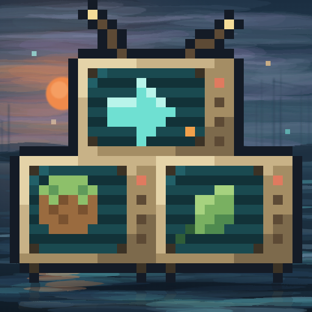
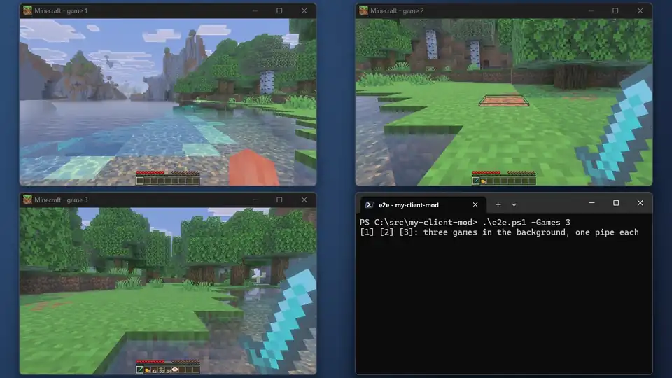

# Be.D.D.



[English](README.md) | 简体中文

[](https://github.com/LiteLDev/BeDD/releases)
[](COPYING.LESSER)
[](https://docs.levimc.org/BeDD/zh/)

Be.D.D.（Bedrock Deep Dive，得名自《绝区零》的 H.D.D.）让 [LeviLamina](https://github.com/LiteLDev/LeviLamina)
客户端模组的端到端测试**在后台跑**：脚本或 agent 通过本机 WebSocket 玩 Minecraft 基岩版，你的鼠标、键盘和窗口照常归你用，
还能同时开多个游戏。它是测试工具，不是给玩家的模组：`BeDD.exe`（管理窗口和命令行）负责克隆、启动和显示游戏，并在每次运行时
往每个游戏里放一个客户端 LeviLamina 模块。

**文档：<https://docs.levimc.org/BeDD/zh/>**

<p align="center"></p>

> [!WARNING]
> `mods\` 目录里有 Be.D.D. 的游戏不理会你真实的鼠标和键盘，只显示在管理窗口里。别把它留在你平时玩的游戏里。

## 安装

从 [Releases](https://github.com/LiteLDev/BeDD/releases) 运行 `bedd-windows-x64-setup.exe`：按用户安装，不需要管理员权限，
装到 `%LOCALAPPDATA%\Programs\BeDD`，`BeDD.exe` 加进 `PATH`，开始菜单加 **BeDD**。`bedd-windows-x64.msi` 内容相同，
用于静默安装（`msiexec /i bedd-windows-x64.msi /qn`）；`bedd-windows-x64.zip` 不用安装。每个都包含：

| | |
|---|---|
| `BeDD/BeDD.exe` | 应用本身：管理窗口和命令行 |
| `BeDD/mod/BeDD/` | `BeDD.exe` 每次运行时放进游戏的客户端模块 |
| `BeDD/mod/BeDD-server/` | 基岩版专用服务器用的模块（客户端与服务端模式） |
| `BeDD/spec/` | `bedd.asyncapi.yaml`，WebSocket 协议 |

需要 Minecraft 基岩版 **1.26.60**（GDK）和 LeviLamina **26.60.x**（客户端），装成
[LeviLauncher](https://github.com/LiteLDev/LeviLauncher) **1.1 或更新版本**的实例。不是 lip 包，不在 LeviMC 模组上架；
只有测试机需要它。

`BeDD.exe` 只读取你的 LeviLauncher 实例（`LeviLauncher.exe instance list --json`；LeviLauncher 在别处时设
`BEDD_LEVILAUNCHER`），从不往里写。每个游戏（包括 1 号槽位）都在克隆
`%LOCALAPPDATA%\BeDD\instances\<gameVersion>-<slot>` 里运行：游戏文件是硬链接（跨卷时复制），有自己的 `mods\`、日志、
存档和设置，实例变了会刷新。Be.D.D. 的数据都在 `%LOCALAPPDATA%\BeDD` 下（`BEDD_HOME` 可移动）。
`BeDD.exe instance list [--all] | clone --slot N | remove <name>`。

## 快速上手

```
BeDD.exe launch --slot 2 --json
```

在管理窗口里无头启动 2 号槽位的游戏，不抢焦点；等 WebSocket 开始监听，输出 `pid`、`instance`、`url`、`token` 和 `label`
（也写在 `%LOCALAPPDATA%\BeDD\run\<pid>.json`）后退出；游戏继续运行。`--detach` 在进程一启动就返回，`url` 和 `token` 为 null
（游戏起来后从该文件或 `BeDD.exe ps --json` 读取）。

按这个顺序驱动游戏。游戏层的回答精确又便宜，一个 `ui` 视图只有几百个字符，而截图让 agent 多花得多的 token，像素位置还会失效。

1. **[bedboo](https://github.com/LiteLDev/bedboo)**（`npm i bedboo`），在真实客户端上运行的 mineflayer 风格机器人：

   ```js
   import { execFileSync } from 'node:child_process';
   import bedboo from 'bedboo';
   const { url, token } = JSON.parse(execFileSync('BeDD.exe', ['launch', '--slot', '2', '--json']));
   const bot = bedboo.createBot({ transport: 'bedd', bedd: { url, token } });
   bot.once('spawn', () => bot.chat('hello'));
   ```

   不用 bedboo 时自己发它的操作：`world`、`look`、`input`、`slot`、`action`、`button`、`settings`、`send`、`stack`、
   `timescale`、`join`、`tap`。请求 `{id, op, ...}` 在游戏处理完后得到 `{id, ok:true, ...}` 或
   `{id, ok:false, error, code}`（Node 22+）：

   ```js
   const ws = new WebSocket(`${url}?token=${token}`), waiting = new Map(); let id = 0;
   ws.onmessage = (e) => { const m = JSON.parse(e.data); waiting.get(m.id)?.(m); waiting.delete(m.id); };
   const call = (op, args = {}) => new Promise((r) => { waiting.set(++id, r); ws.send(JSON.stringify({ id, op, ...args })); });
   await new Promise((r) => { ws.onopen = r; });
   console.log(await call('ping'), await call('world')); // modes on offer; screen and player
   ```

2. **`ui`**，用于 bedboo 覆盖不到的菜单和界面：`await call('ui')` 回复 `{ok, view, screen, truncated}`，每个控件一行，
   能执行动作的带 `[ref]`：

   ```
   screen start_screen
   - button "Play" [e1]
   - button "Settings" [e2]
   - text "v26.60/LeviLamina-26.60.5"
   under: toast_screen, debug_screen, cubemap_background_screen
   ```

   `await call('ui', { action: 'click', ref: 'e1' })` 点击 Play（还有 `setText`、`scroll`）。
3. **模拟输入**，最后手段：`key`、`text`、`mouse`、`raw`、`release`、`flush`、`focus`、`window`、`screenshot`。

协议：[`spec/bedd.asyncapi.yaml`](spec/bedd.asyncapi.yaml)（AsyncAPI 3.0）和
[WebSocket 参考](https://docs.levimc.org/BeDD/zh/reference/websocket)。

## 命令

`BeDD.exe help` 列出所有命令。每个命令都支持 `--json`，stdout 只输出结果，失败时以非零退出并给出提示。`BeDD.exe ps`
列出运行中的游戏（`--json`：带 `url`、`token`）；`BeDD.exe stop <pid>` 关掉一个。

- **多开**：每个游戏一条 `launch --slot 3 --label settings --json`；每个槽位有自己的克隆和 WebSocket。按 `instance`
  （`ps --json`）找自己的游戏，从不按名字 `Minecraft.Windows`。把测试存档设成单人（`BeDD.exe world singleplayer <worldDir>`）：
  同一台电脑上的游戏共用一个联机登录，同时打开多个多人存档会报"发生错误"（代码 "Blaze"）。
- **客户端与服务端**：`BeDD.exe server init|start|stop s1` 在游戏旁运行装有 BeDD 服务端模块的基岩版专用服务器，
  游戏速度以它为准（[世界模式](https://docs.levimc.org/BeDD/zh/guide/modes)）。
- **管理窗口**：不带参数的 `BeDD.exe`（第一次 `launch` 会启动它）是游戏唯一显示的地方；它从不抢焦点。关掉它会关掉里面所有游戏
  （先确认）；30 秒内没被它接管或失去它的游戏会自行关闭。`BeDD.exe manager status|stop`。
- **测试框架**：

  ```
  BeDD.exe instance clone --slot 2 --json           # where the clone is (its mods\ and worlds)
  BeDD.exe mod install 1.26.60.05-2                 # the BeDD module; settings: mod config
  BeDD.exe world singleplayer <the clone's world>   # after restoring your test world
  BeDD.exe launch --slot 2 --json                   # url + token
  BeDD.exe stop <pid>; BeDD.exe mod uninstall 1.26.60.05-2
  ```

  你自己的模组也部署进克隆的 `mods\`，并让任何"把其他模组挪开"的步骤跳过 `BeDD`。
  [BeetrootSkin](https://github.com/MiracleForest/BeetrootSkin/tree/main/tools/e2e) 和
  [AlleviatedBackpacks](https://github.com/MiracleForest/AlleviatedBackpacks/tree/main/tools/e2e) 有完整的测试框架。

设置（克隆的 `mods\BeDD\config\config.json`）：[配置](https://docs.levimc.org/BeDD/zh/guide/configuration)。
令牌就是边界：持有它的人能做登录玩家能做的一切；它只写进 `%LOCALAPPDATA%\BeDD\run\<pid>.json`，只有你的用户能读。

构建、协议内部原理和贡献：[CONTRIBUTING.md](CONTRIBUTING.md#development)。

## 许可证

[LGPL-3.0-or-later](COPYING.LESSER) © LeviMC。GameInput 接口布局参照微软公开的 `GameInput.h`（v2），不包含任何微软代码。
